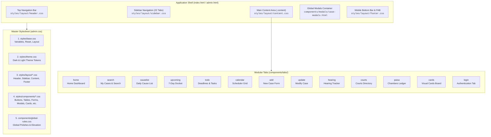
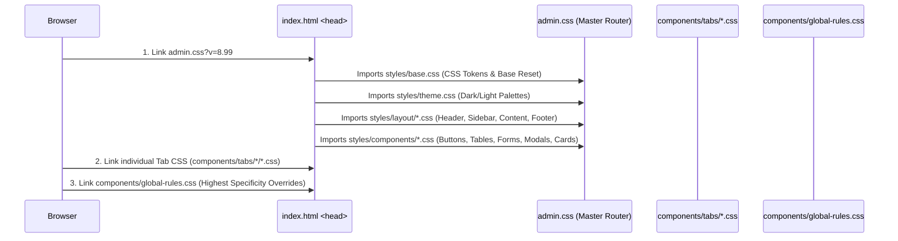

# CaseBook CMS: Complete Component & Style Architecture

Yeh guide **CaseBook Modular Application** ke saare **Components (HTML/JS)** aur unke corresponding **Styles (CSS)** ke connection aur hierarchy ka complete roadmap hai.

---

## 1. High-Level Architecture Diagram

---

## 2. Style Loading Hierarchy & Cascade Order

Styles browser mein is exact sequence mein load aur apply hote hain:

---

## 3. Master Style Modules (`styles/`)

| Module Directory | File Name | Primary Selectors / Purpose | Imported In |
| :--- | :--- | :--- | :--- |
| **`styles/`** | [`base.css`](file:///d:/caseBook-modular/styles/base.css) | `:root`, `html.dark`, `#adminScreen`, `#guestScreen`, scrollbars, typography tokens. | `admin.css` |
| **`styles/`** | [`theme.css`](file:///d:/caseBook-modular/styles/theme.css) | Theme switcher (`.theme-option-card`), dark mode palette variables, theme chips. | `admin.css` |
| **`styles/layout/`** | [`header.css`](file:///d:/caseBook-modular/styles/layout/header.css) | `.top-header`, `.materialize-nav`, `#searchContainer`, `#searchInput`, `#adminLogoutBtn`. | `admin.css` |
| **`styles/layout/`** | [`sidebar.css`](file:///d:/caseBook-modular/styles/layout/sidebar.css) | `nav.sidebar`, `.sidenav`, `.sidebar-overlay`, active nav items (`a.active`), badges. | `admin.css` |
| **`styles/layout/`** | [`content.css`](file:///d:/caseBook-modular/styles/layout/content.css) | `.content`, `.tab`, `.tab.active` transitions, spacing clearance (56px). | `admin.css` |
| **`styles/layout/`** | [`footer.css`](file:///d:/caseBook-modular/styles/layout/footer.css) | `#fixedBottomNav`, `.mobile-fab-btn`, mobile sliding action drawers. | `admin.css` |
| **`styles/components/`** | [`buttons.css`](file:///d:/caseBook-modular/styles/components/buttons.css) | `.primary-btn`, `.secondary-btn`, `.danger-btn`, `.nav-icon-action-btn`. | `admin.css` |
| **`styles/components/`** | [`tables.css`](file:///d:/caseBook-modular/styles/components/tables.css) | `.case-table`, `.table-container`, row hover states, status pills. | `admin.css` |
| **`styles/components/`** | [`forms.css`](file:///d:/caseBook-modular/styles/components/forms.css) | `.form-container`, `.form-group`, `input`, `select`, `textarea`, floating labels. | `admin.css` |
| **`styles/components/`** | [`cards.css`](file:///d:/caseBook-modular/styles/components/cards.css) | `.card`, `.home-panel-card`, `.kpi-rect-card`, elevation shadows, borders. | `admin.css` |
| **`styles/components/`** | [`modals.css`](file:///d:/caseBook-modular/styles/components/modals.css) | `.modal`, `.modal-content`, `.modal-overlay`, backdrop blur animations. | `admin.css` |
| **`styles/components/`** | [`badges.css`](file:///d:/caseBook-modular/styles/components/badges.css) | `.badge`, case type badges (`.badge-civil`, `.badge-criminal`, etc.). | `admin.css` |
| **`styles/components/`** | [`toast.css`](file:///d:/caseBook-modular/styles/components/toast.css) | `.toast`, notification popups, live feedback banners. | `admin.css` |
| **`styles/components/`** | [`auth.css`](file:///d:/caseBook-modular/styles/components/auth.css) | `.auth-shell`, session lock screen utility rules. | `admin.css` |
| **`styles/components/`** | [`pwa.css`](file:///d:/caseBook-modular/styles/components/pwa.css) | `.pwa-install-banner-btn`, installation prompt modal styling. | `admin.css` |
| **`styles/components/`** | [`scrollbars.css`](file:///d:/caseBook-modular/styles/components/scrollbars.css) | WebKit scrollbar track, thumb, and hover states. | `admin.css` |
| **`components/`** | [`global-rules.css`](file:///d:/caseBook-modular/components/global-rules.css) | High-priority theme overrides, dark mode fine-tuning, responsive adjustments. | `<link>` |

---

## 4. Complete Tab Components Directory (`components/tabs/`)

Har ek tab ka apna dedicated HTML template, CSS styling aur JavaScript module hai:

| Tab ID | Tab Name | HTML Template Source | Stylesheet Source | JS Controller Source | Key Functionality |
| :--- | :--- | :--- | :--- | :--- | :--- |
| **`home`** | Home Dashboard | [`home.html`](file:///d:/caseBook-modular/components/tabs/home/home.html) | [`home.css`](file:///d:/caseBook-modular/components/tabs/home/home.css) | [`home.js`](file:///d:/caseBook-modular/components/tabs/home/home.js) | Hero card, KPI metrics, today's schedule, charts. |
| **`search`** | My Cases | [`search.html`](file:///d:/caseBook-modular/components/tabs/search/search.html) | [`search.css`](file:///d:/caseBook-modular/components/tabs/search/search.css) | [`search.js`](file:///d:/caseBook-modular/components/tabs/search/search.js) | Live instant search, category filters, results grid. |
| **`causelist`** | Daily Cause List | [`causelist.html`](file:///d:/caseBook-modular/components/tabs/causelist/causelist.html) | [`causelist.css`](file:///d:/caseBook-modular/components/tabs/causelist/causelist.css) | [`causelist.js`](file:///d:/caseBook-modular/components/tabs/causelist/causelist.js) | Date picker, court filter, daily appearance board. |
| **`upcoming`** | Upcoming Hearings | [`upcoming.html`](file:///d:/caseBook-modular/components/tabs/upcoming/upcoming.html) | [`upcoming.css`](file:///d:/caseBook-modular/components/tabs/upcoming/upcoming.css) | [`upcoming.js`](file:///d:/caseBook-modular/components/tabs/upcoming/upcoming.js) | 7-day judicial docket, upcoming countdown pills. |
| **`calendar`** | Calendar Scheduler | [`calendar.html`](file:///d:/caseBook-modular/components/tabs/calendar/calendar.html) | [`calendar.css`](file:///d:/caseBook-modular/components/tabs/calendar/calendar.css) | [`calendar.js`](file:///d:/caseBook-modular/components/tabs/calendar/calendar.js) | Visual monthly calendar with hearing dots & badges. |
| **`todo`** | To-Do & Deadlines | [`todo.html`](file:///d:/caseBook-modular/components/tabs/todo/todo.html) | [`todo.css`](file:///d:/caseBook-modular/components/tabs/todo/todo.css) | [`todo.js`](file:///d:/caseBook-modular/components/tabs/todo/todo.js) | Legal deadline tracker, priority flags, checklist items. |
| **`add`** | Add New Case | [`add.html`](file:///d:/caseBook-modular/components/tabs/add/add.html) | [`add.css`](file:///d:/caseBook-modular/components/tabs/add/add.css) | [`add.js`](file:///d:/caseBook-modular/components/tabs/add/add.js) | Case entry form with dynamic fields by case category. |
| **`update`** | Update Case | [`update.html`](file:///d:/caseBook-modular/components/tabs/update/update.html) | [`update.css`](file:///d:/caseBook-modular/components/tabs/update/update.css) | [`update.js`](file:///d:/caseBook-modular/components/tabs/update/update.js) | Edit case metadata, parties, and court assignments. |
| **`hearing`** | Update Hearing | [`hearing.html`](file:///d:/caseBook-modular/components/tabs/hearing/hearing.html) | [`hearing.css`](file:///d:/caseBook-modular/components/tabs/hearing/hearing.css) | [`hearing.js`](file:///d:/caseBook-modular/components/tabs/hearing/hearing.js) | Post-hearing outcomes, next date log, orders. |
| **`transfer`** | Transfer Case | [`transfer.html`](file:///d:/caseBook-modular/components/tabs/transfer/transfer.html) | [`transfer.css`](file:///d:/caseBook-modular/components/tabs/transfer/transfer.css) | [`transfer.js`](file:///d:/caseBook-modular/components/tabs/transfer/transfer.js) | Case forum transfer history and audit logs. |
| **`delete`** | Delete Case | [`delete.html`](file:///d:/caseBook-modular/components/tabs/delete/delete.html) | [`delete.css`](file:///d:/caseBook-modular/components/tabs/delete/delete.css) | [`delete.js`](file:///d:/caseBook-modular/components/tabs/delete/delete.js) | Controlled case purging with confirmation safeguards. |
| **`courts`** | Court Directory | [`courts.html`](file:///d:/caseBook-modular/components/tabs/courts/courts.html) | [`courts.css`](file:///d:/caseBook-modular/components/tabs/courts/courts.css) | [`courts.js`](file:///d:/caseBook-modular/components/tabs/courts/courts.js) | Manage list of courts, rooms, and bench judges. |
| **`helpers`** | Staff & Advocates | [`helpers.html`](file:///d:/caseBook-modular/components/tabs/helpers/helpers.html) | [`helpers.css`](file:///d:/caseBook-modular/components/tabs/helpers/helpers.css) | [`helpers.js`](file:///d:/caseBook-modular/components/tabs/helpers/helpers.js) | Chambers assistants, junior counsels, phone contacts. |
| **`paisa`** | Accounts & Ledger | [`paisa.html`](file:///d:/caseBook-modular/components/tabs/paisa/paisa.html) | [`paisa.css`](file:///d:/caseBook-modular/components/tabs/paisa/paisa.css) | [`paisa.js`](file:///d:/caseBook-modular/components/tabs/paisa/paisa.js) | Chambers financial manager, fee tracking, ledger. |
| **`all`** | All Cases Registry | [`all.html`](file:///d:/caseBook-modular/components/tabs/all/all.html) | [`all.css`](file:///d:/caseBook-modular/components/tabs/all/all.css) | [`all.js`](file:///d:/caseBook-modular/components/tabs/all/all.js) | Comprehensive filterable data grid for all matters. |
| **`cards`** | Case Cards Board | [`cards.html`](file:///d:/caseBook-modular/components/tabs/cards/cards.html) | [`cards.css`](file:///d:/caseBook-modular/components/tabs/cards/cards.css) | [`cards.js`](file:///d:/caseBook-modular/components/tabs/cards/cards.js) | Visual Trello-style card board for case files. |
| **`undated`** | Undated Cases | [`undated.html`](file:///d:/caseBook-modular/components/tabs/undated/undated.html) | [`undated.css`](file:///d:/caseBook-modular/components/tabs/undated/undated.css) | [`undated.js`](file:///d:/caseBook-modular/components/tabs/undated/undated.js) | Registry of active cases pending hearing dates. |
| **`disposed`** | Disposed Matters | [`disposed.html`](file:///d:/caseBook-modular/components/tabs/disposed/disposed.html) | [`disposed.css`](file:///d:/caseBook-modular/components/tabs/disposed/disposed.css) | [`disposed.js`](file:///d:/caseBook-modular/components/tabs/disposed/disposed.js) | Archive of won, dismissed, or settled matters. |
| **`livecrud`** | Live Database Sync | [`livecrud.html`](file:///d:/caseBook-modular/components/tabs/livecrud/livecrud.html) | [`livecrud.css`](file:///d:/caseBook-modular/components/tabs/livecrud/livecrud.css) | [`livecrud.js`](file:///d:/caseBook-modular/components/tabs/livecrud/livecrud.js) | Direct Supabase CRUD viewer and inspector. |
| **`settings`** | Account & Security | [`settings.html`](file:///d:/caseBook-modular/components/tabs/settings/settings.html) | [`settings.css`](file:///d:/caseBook-modular/components/tabs/settings/settings.css) | [`settings.js`](file:///d:/caseBook-modular/components/tabs/settings/settings.js) | Password update, credentials, theme switcher. |
| **`about`** | Profile & Manual | [`about.html`](file:///d:/caseBook-modular/components/tabs/about/about.html) | [`about.css`](file:///d:/caseBook-modular/components/tabs/about/about.css) | [`about.js`](file:///d:/caseBook-modular/components/tabs/about/about.js) | Advocate profile, developer credits, inline manual. |
| **`login`** | Authentication Portal | [`login.html`](file:///d:/caseBook-modular/components/tabs/login/login.html) | [`login.css`](file:///d:/caseBook-modular/components/tabs/login/login.css) | [`login.js`](file:///d:/caseBook-modular/components/tabs/login/login.js) | Tab-based login form, remember me, guest mode. |

---

## 5. Global Modals & Print Templates

| Component | Markup Source | Style Source | Script Source | Role |
| :--- | :--- | :--- | :--- | :--- |
| **Case Modals** | [`components/modals/case-modals.html`](file:///d:/caseBook-modular/components/modals/case-modals.html) | [`styles/components/modals.css`](file:///d:/caseBook-modular/styles/components/modals.css) | [`components/modals/case-modals.js`](file:///d:/caseBook-modular/components/modals/case-modals.js) | Edit Case Modal, Edit Court Modal, Edit Helper Modal. |
| **Print Templates** | [`components/print/print-templates.html`](file:///d:/caseBook-modular/components/print/print-templates.html) | Injected Inline & `admin.css` | [`components/print/print-templates.js`](file:///d:/caseBook-modular/components/print/print-templates.js) | Daily Cause List Print, Case File Brief Print, Accounts Receipt Print. |

---

## 6. How To Customize Any Element (Quick Cheatsheet)

1. **Agar Top Navigation Header badalna hai**:
   - Markup: [`index.html`](file:///d:/caseBook-modular/index.html) *(Lines 466–646)*
   - Style: [`styles/layout/header.css`](file:///d:/caseBook-modular/styles/layout/header.css)
2. **Agar Sidebar badalna hai**:
   - Markup: [`index.html`](file:///d:/caseBook-modular/index.html) *(Lines 654–765)*
   - Style: [`styles/layout/sidebar.css`](file:///d:/caseBook-modular/styles/layout/sidebar.css)
3. **Agar kisi specific Tab (jaise Search, Home, ya Paisa) ko customize karna hai**:
   - Template: `components/tabs/<tab-name>/<tab-name>.html`
   - Styles: `components/tabs/<tab-name>/<tab-name>.css`
   - Logic: `components/tabs/<tab-name>/<tab-name>.js`
4. **Agar Buttons ya Input boxes badalne hain**:
   - Styles: [`styles/components/buttons.css`](file:///d:/caseBook-modular/styles/components/buttons.css) & [`styles/components/forms.css`](file:///d:/caseBook-modular/styles/components/forms.css)
5. **Agar Cards ya Panels ka shadow/border badalna hai**:
   - Styles: [`styles/components/cards.css`](file:///d:/caseBook-modular/styles/components/cards.css)
