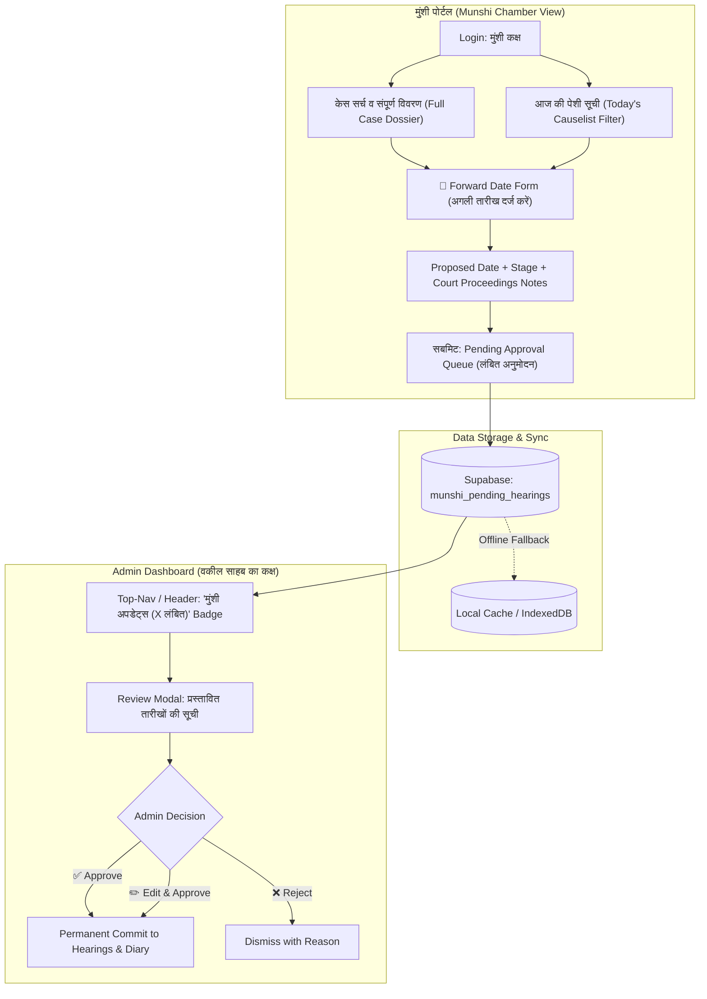

# 🏛️ CaseBook Munshi Portal (मुंशी कक्ष) - Implementation Plan

> **लक्ष्य:** वर्तमान *Guest Portal* को एक समर्पित, सुरक्षित और सुव्यवस्थित **"Munshi Portal" (Court Clerk Portal)** में बदलना, जिससे मुंशी जी कचहरी में रोज़ाना केसों की संपूर्ण जानकारी देख सकें और अगली सुनवाई की तारीख (Next Hearing Date) प्रस्तावित कर सकें — जो वकील साहब (Admin) के रिव्यू और अप्रूवल के बाद ही स्थायी रूप से सुरक्षित (permanently save) होगी।

---

## 1. आर्किटेक्चर एवं कार्यप्रवाह (Architecture & Flow)



---

## 2. डेटाबेस स्कीमा (Supabase Schema)

मुंशी जी द्वारा भेजी गई तारीखें सीधे मुख्य केस टेबल में जाने के बजाय पहले **`munshi_pending_hearings`** में स्टोर होंगी:

```sql
-- Migration: Create Munshi Pending Hearings Table
CREATE TABLE IF NOT EXISTS public.munshi_pending_hearings (
    id UUID DEFAULT gen_random_uuid() PRIMARY KEY,
    case_number TEXT NOT NULL,
    case_name TEXT,
    court_name TEXT,
    current_hearing_date DATE,
    proposed_next_date DATE NOT NULL,
    proposed_stage TEXT NOT NULL,
    proceedings_notes TEXT,
    submitted_by TEXT DEFAULT 'Munshi Ji',
    submitted_at TIMESTAMPTZ DEFAULT NOW(),
    status TEXT DEFAULT 'pending' CHECK (status IN ('pending', 'approved', 'rejected')),
    reviewed_at TIMESTAMPTZ,
    reviewed_by TEXT,
    review_remarks TEXT,
    created_at TIMESTAMPTZ DEFAULT NOW(),
    updated_at TIMESTAMPTZ DEFAULT NOW()
);

-- Indexing for rapid queue fetching
CREATE INDEX IF NOT EXISTS idx_munshi_pending_status ON public.munshi_pending_hearings(status);
CREATE INDEX IF NOT EXISTS idx_munshi_pending_case_no ON public.munshi_pending_hearings(case_number);

-- Enable Row Level Security (RLS)
ALTER TABLE public.munshi_pending_hearings ENABLE ROW LEVEL SECURITY;

-- Allow authenticated users & munshi sessions to read/insert
CREATE POLICY "Allow read pending hearings" ON public.munshi_pending_hearings
    FOR SELECT USING (true);

CREATE POLICY "Allow insert pending hearings" ON public.munshi_pending_hearings
    FOR INSERT WITH CHECK (true);

CREATE POLICY "Allow update pending hearings by admin" ON public.munshi_pending_hearings
    FOR UPDATE USING (true);
```

---

## 3. मॉड्यूल-वार कार्य योजना (Component Breakdown)

### 3.1. मॉड्यूल 1: ऑथेंटिकेशन व पोर्टल एंट्री (Auth & Entry)
1. **Login Page Rebrand**:
   - `index.html` में वर्तमान "Guest Access / Guest Chamber" बटन को **"Munshi Chamber (मुंशी पोर्टल)"** में बदलेंगे।
   - आईकन: `<iconify-icon icon="lucide:user-check"></iconify-icon>`।
   - सेशन स्टोर: `safeStorage.set('cmUser', 'munshi', false)`।
2. **Session Handling**:
   - मुंशी जी को सिर्फ केस डिटेल्स देखने और तारीखें प्रस्तावित करने का अधिकार रहेगा; सेटिंग्स, फीस और डिलीट के अधिकार बंद रहेंगे।

---

### 3.2. मॉड्यूल 2: मुंशी पोर्टल स्क्रीन (`#guestScreen` -> `#munshiScreen`)
1. **Header Bar**:
   - ब्रांड लोगो: `CaseBook` + बैज: **`Munshi Portal (मुंशी कक्ष)`**।
   - राइट साइड: आज की तारीख डिस्प्ले, सिंक स्टेटस, लॉगआउट बटन।
2. **स्मार्ट फिल्टर और सर्च पैनल (Smart Filters & Search)**:
   - **आज की पेशी (Today's Cases Quick Pill)**: एक क्लिक में आज कोर्ट में लगी हुई सभी फाइलों की लिस्ट (ताकि मुंशी जी को कचहरी में 1-1 केस न ढूंढना पड़े)।
   - **सर्च इनपुट**: केस नंबर, पार्टी नाम, कोर्ट, या क्लाइंट मोबाइल नंबर से त्वरित खोज।
3. **केस कार्ड्स और टेबल (Case List & Selection)**:
   - प्रत्येक केस के लिए:
     - केस नंबर व साल (बोल्ड)
     - कोर्ट का नाम (उदा. ADJ-1, ACJM-2)
     - पार्टी नाम (उदा. वादी बनाम प्रतिवादी / State vs ...)
     - वर्तमान सुनवाई तारीख व स्टेज
     - **कार्रवाई बटन:** `[ 📅 Forward Date (तारीख बढ़ाएं) ]` एवं `[ 👁️ Full Dossier (पूरा विवरण) ]`
4. **संपूर्ण केस विवरण पैनल (Full Case Dossier)**:
   - पार्टी विवरण (Applicant, Opposite Party, Police Station, Crime No/FIR, Sections)।
   - केस की पुरानी तारीखों का इतिहास (Hearing History & past proceedings)।
   - केस दस्तावेज़ व आदेश पत्रक लिंक (Order sheet docs)।

---

### 3.3. मॉड्यूल 3: मुंशी डेट फॉरवर्ड मॉडल (Forward Next Date Modal)
जब मुंशी जी किसी केस में तारीख आगे बढ़ाएंगे, तो उनके सामने एक विशेष **फास्ट-एंट्री फॉर्म** खुलेगा:
- **केस की जानकारी:** केस नंबर, कोर्ट और पुरानी तारीख।
- **Next Hearing Date (अगली तारीख):**
  - सुगम कैलेंडर पिकर + क्विक प्रेसेट्स (+7 दिन, +14 दिन, +1 माह)।
  - रविवार (Sunday) या अवकाश होने पर अलर्ट/चेतावनी।
- **Next Case Stage (कार्यवाही/स्टेज):**
  - रेडीमेड चिप्स: `Evidence (साक्ष्य)`, `Arguments (बहस)`, `Framing of Charge (आरोप तय)`, `Notice/Summons (समन/नोटिस)`, `Disposal (निस्तारण)`, `Other`।
- **Court Proceedings Notes (अदालती कार्यवाही विवरण):**
  - मुंशी जी कोर्ट की डायरी का विवरण लिख सकेंगे (उदा. *"गवाह PW-1 नहीं आया, अदालत ने 500 रु. हर्जाने पर अगली तारीख दी"*).
- **सबमिट बटन:** `[ 🚀 Submit for Lawyer's Approval ]`
  - सबमिट होते ही केस के आगे **`लंबित अनुमोदन (Pending Approval)`** का येलो बैज लग जाएगा।

---

### 3.4. मॉड्यूल 4: Admin (वकील साहब) Review & Approval Dashboard
वकील साहब जब अपने एडमिन पोर्टल में लॉगिन करेंगे:
1. **Top Header / Home Dashboard Notification**:
   - हेडर में घंटी/अलर्ट बैज: `🔔 मुंशी जी के 3 अपडेट्स समीक्षा हेतु उपलब्ध हैं`।
2. **Review & Approval Drawer / Modal**:
   - लंबित आवेदनों की स्पष्ट तुलना (Comparison Diff):
     | विवरण | वर्तमान डेटा | मुंशी जी द्वारा प्रस्तावित |
     | :--- | :--- | :--- |
     | **अगली तारीख** | 09-Nov-2026 | **24-Nov-2026** *(+15 दिन)* |
     | **स्टेज** | Summoning | **Framing of Charge** |
     | **कोर्ट नोट्स** | — | *"विपक्षी पेश हुआ, चार्ज तय होना है"* |
3. **Approval Actions**:
   - **✅ Approve & Save (स्वीकारें):** एक क्लिक में स्थायी रूप से `hearings` और केस टेबल में तारीख अपडेट हो जाएगी।
   - **✏️ Edit & Approve (संशोधित कर स्वीकारें):** यदि मुंशी जी ने स्टेज या तारीख में कोई भूल की है, तो वकील साहब उसे एडिट करके सेव कर सकेंगे।
   - **❌ Reject (अस्वीकारें):** यदि गलत केस में तारीख डल गई हो तो कारण लिखकर खारिज किया जा सकेगा।

---

## 4. स्ट्रिक्ट UI रूल्स व डिज़ाइन अनुपालन (Strict UI Rules Compliance)

1. **Rule 1: Uniform Design System**:
   - केसबुक के मौजूदा CSS वेरिएबल्स (`--bg-surface`, `--text-heading`, `--border-color`, `--accent-brand`) और कार्ड स्ट्रक्चर का ही उपयोग होगा।
   - लाइट और डार्क दोनों थीमों में हाई-कंट्रास्ट (WCAG AA 4.5:1+) सुनिश्चित रहेगा।
2. **Rule 2: Lucide Icons Only**:
   - सभी पुराने इमोजी (`🔒`, `❌`, `📋`, `🔍`, `🔗`) और FontAwesome (`fa-print`, `fa-eye`, `fa-plus`) पूरी तरह हटाए जाएंगे।
   - केवल Lucide आईकन्स प्रयुक्त होंगे:
     - `lucide:user-check` (मुंशी पोर्टल लोगो)
     - `lucide:calendar-plus` (तारीख आगे बढ़ाना)
     - `lucide:clock` (लंबित स्थिति)
     - `lucide:check-circle-2` (स्वीकृत)
     - `lucide:x-circle` (अस्वीकृत)
     - `lucide:printer` (प्रिंट)
3. **Rule 3: Strict Tab Isolation**:
   - सभी नए स्टाइल्स `:is(#guestScreen, [data-munshi-scope])` और एडमिन अप्रूवल के स्टाइल्स `:is(#adminReviewModal, [data-approval-scope])` के अंतर्गत ही स्कोप्ड रहेंगे।
   - अन्य किसी भी टैब (Calendar, Todo, Accounts, Home) के लेआउट या बिहेवियर पर शून्य दुष्प्रभाव रहेगा।

---

## 5. चरणबद्ध क्रियान्वयन योजना (Phased Implementation Roadmap)

```
[Phase 1: DB Schema & Service]
 ├── supabase_munshi_hearings_migration.sql तैयार करना
 └── services/munshiService.js (Create, Fetch Pending, Approve, Reject)
       │
[Phase 2: Munshi Portal UI Refactor]
 ├── index.html में Guest Screen को Munshi Portal में अपग्रेड करना
 ├── Lucide Icons से सभी इमोजी व FontAwesome को बदलना
 └── Today's Hearings + Case Search + Full Case Dossier View
       │
[Phase 3: Forward Date Modal for Munshi]
 ├── तारीख, स्टेज चिप्स, और कोर्ट नोट्स एंट्री फॉर्म
 └── Submit to Pending Queue with instant feedback
       │
[Phase 4: Admin Approval Interface]
 ├── Admin Navbar में 'Pending Munshi Updates' काउंटर बैज
 └── Review & Approval Drawer (Approve / Edit / Reject buttons)
       │
[Phase 5: Testing & Verification]
 ├── Munshi द्वारा तारीख डालना -> Admin द्वारा Approve करना -> डायरी में सेव होना
 └── डार्क/लाइट थीम, मोबाइल व्यू और ऑफलाइन टेस्ट
```

---

## 6. अगला कदम (Next Step)

यह विस्तृत योजना तैयार है। जब भी आप शुरू करने का निर्देश देंगे, हम **चरण 1 (Phase 1)** से कोडिंग और इंटीग्रेशन शुरू कर देंगे।
