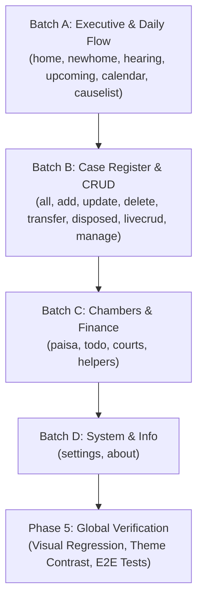

# CaseBook Modular — Tab-Wise Polishing Plan

> **Inherited Blueprint:** This plan strictly inherits and operationalizes all rules, tokens, and standards defined in [DESIGN_PLAN.md](file:///d:/caseBook-modular/DESIGN_PLAN.md) and [.agents/rules/ui-rules.md](file:///d:/caseBook-modular/.agents/rules/ui-rules.md).

---

## 1. Inherited Design Rules & Standards (Core Tenets)

Every tab polished under this plan **MUST** pass these 10 non-negotiable architectural rules:

1. **Strict Tab Isolation & Zero Leakage:**
   - 100% of selectors in `tab-[name].css` must be nested under `:is(#[name], [data-[name]-scope])`.
   - Never write broad global selectors (e.g., unqualified `button`, `table`, `input`, `.card`) that could affect sibling tabs.
2. **Exclusively Lucide Icons:**
   - Only Lucide vector icons (`<i data-lucide="..."></i>` or SVG rendered via `utils/lucideIcons.js`).
   - Zero emojis or alternative icon libraries in UI elements, headers, tables, buttons, or badges.
3. **Zero Hard-Coded Colors (Strict Token Architecture):**
   - Absolutely no raw hex (`#...`), `rgb()`, or `hsl()` in tab CSS or inline markup.
   - Use semantic design tokens: `var(--bg-canvas)`, `var(--bg-card)`, `var(--text-primary)`, `var(--text-muted)`, `var(--border-subtle)`, `var(--border-default)`, `var(--cb-brand-gold)`, `var(--cb-brass-*)`.
4. **Soft Border Philosophy:**
   - Hairline borders with calibrated subtle contrast (`var(--border-subtle)` / `var(--border-default)`).
   - High-contrast, harsh, or pure black borders are strictly prohibited.
5. **Universal Component DRYness:**
   - Reuse standardized classes from `styles/components.css` (e.g., `.btn`, `.btn-primary`, `.stat-card`, `.data-table`, `.badge`, `.filter-chip`).
   - Eliminate redundant component definitions within tab-specific CSS.
6. **Eradication of Browser & WebKit Defaults:**
   - Uniform reset for number spinners (`::-webkit-inner-spin-button`), native datepicker icons, and clear buttons.
   - Cohesive slim scrollbars (`var(--scrollbar-thumb)`) and `.no-scrollbar` where appropriate.
   - Clean custom focus rings using `var(--shadow-focus)`; no default browser blue outlines.
7. **Tailwind-Theme Glow Borders on Primary CTAs:**
   - Major action buttons (e.g., Save Case, Forward Date, Record Payment) must feature the designated glow border (`--btn-glow-border`, `--btn-glow-shadow` / `.btn-glow`).
8. **Strict Mobile-First Responsiveness:**
   - Zero horizontal overflow across viewports (375px to 1440px+).
   - Touch targets must be at least 44px on mobile devices.
   - High-density desktop data tables must adapt into stacked mobile docket cards.
9. **Typography & Monospace Discipline:**
   - Headings & body: `Plus Jakarta Sans` / `Inter` with controlled fluid scale.
   - Rupee amounts (`₹`), Case numbers, CNR numbers, and dates must use tabular monospace (`font-variant-numeric: tabular-nums`).
10. **State Completeness & Micro-Interactions:**
    - Each tab must have polished Empty States (Lucide icon + clear call-to-action).
    - Shimmer loading skeletons matching exact layout shapes (no generic spinners).
    - Smooth tactile micro-interactions (`:active` depression, `var(--transition-fast)`).

---

## 2. Standard 8-Point Tab Polishing Checklist (Quality Gate)

For each tab to be marked **Polished [x]**, it must complete this verification gate:

| # | Inspection Item | Verification Method |
|---|---|---|
| **Q1** | **Scoping Audit** | Grep CSS to verify 100% of rules begin with `:is(#<tab>, [data-<tab>-scope])`. |
| **Q2** | **Color Token Compliance** | Zero hex/rgb codes in `tab-<tab>.css` or HTML inline styles. |
| **Q3** | **Icon Uniformity** | 100% Lucide icons; zero emojis; correct sizing (`--icon-xs` to `--icon-lg`). |
| **Q4** | **Dual Theme Verification** | Flawless contrast in Light Mode, Slate Dark, and Midnight Theme. |
| **Q5** | **Mobile Responsiveness** | Test at 375px, 768px, and 1280px; verify 44px touch targets & zero horizontal overflow. |
| **Q6** | **Table & Card Polish** | Desktop grid/table aligns cleanly; mobile collapses into touch-friendly cards. |
| **Q7** | **Interactive States** | Hover, active, focus-visible (`--shadow-focus`), disabled, and glow CTA verified. |
| **Q8** | **Empty & Loading States** | Dedicated skeleton loaders + clean empty state illustrated with Lucide icons. |

---

## Progress Tracker

| Batch | Phase | Tabs Included | Status |
| :--- | :--- | :--- | :--- |
| **Batch A** | Executive & Daily Court Workflow | `home`, `newhome`, `hearing`, `upcoming`, `calendar`, `causelist` | **Completed (100% Tested)** |
| **Batch B** | Case Register & CRUD Operations | `all`, `add`, `update`, `delete`, `transfer`, `disposed`, `livecrud`, `manage` | **Completed (100% Tested)** |
| **Batch C** | Practice Management & Finance | `paisa`, `todo`, `courts`, `helpers` | **Completed (100% Tested)** |
| **Batch D** | System, Settings & Chamber Utilities | `settings`, `about` | **Completed (100% Tested)** |
| **Phase 5** | Cross-Tab & Regression Verification | 20 Tabs (Theme, Responsive, Vitest Suites) | **Completed (100% Tested — 320 Tests Passed)** |

---

## 3. Tab-by-Tab Polishing Roadmap (20 Tabs in 4 Batches)

---

### Batch A: Executive Dashboards & Daily Court Workflow (6 Tabs) [Completed]

#### 1. `home` — Executive Command Center
- [x] **CSS Scoping & Token Audit:** Scoped under `:is(#home, [data-home-scope])` with zero cross-tab leaks.
- [x] **KPI Stat Cards Polish:** 4 operational stat tiles using uniform tokens, subtle borders, and smooth hover elevation.
- [x] **Judicial Docket Table:** Polished desktop docket layout with tabular dates, case status badges, and quick-action buttons.
- [x] **Mobile Docket Transformation:** Court docket cleanly transitions into stacked cards on viewport `< 768px`.
- [x] **Action CTA Glow:** Applied `--btn-glow-border` and `--btn-glow-shadow` to "New Case" and primary actions.

#### 2. `newhome` — Zen Minimalist Dashboard
- [x] **Scoping & Token Audit:** Enforced `:is(#newhome, [data-newhome-scope])` scoping across 100% of rules.
- [x] **Minimalist Rhythm:** Generous spacing, 8pt rhythm, and distraction-free daily priority overview.
- [x] **Lucide Alignment:** Standardized Lucide vector icons for all metric boxes, kicker, and actions.
- [x] **Theme Contrast:** Contrast verified against Midnight, Dark, and Light parchment themes.
- [x] **Tailwind Glow CTA:** Primary buttons polished with `--btn-glow-border` and `--btn-glow-shadow`.

#### 3. `hearing` — Daily Court Hearings & Forward-Date Workflow
- [x] **Scoping & Token Audit:** Scoped under `:is(#hearing, [data-hearing-scope])`.
- [x] **Hearing Row Actions:** Tactile micro-interactions on stage pills, presets, and order snippets.
- [x] **Forward-Date Inline Sheet:** Zero WebKit defaults, token-based datepicker, and custom dropdowns.
- [x] **Mobile Touch Polish:** 48px tap targets on `#hearingSubmitBtn` and controls for courtroom usage.
- [x] **Action CTA Glow:** Forward Date CTA polished with Tailwind theme glow ring and active depression.

#### 4. `upcoming` — Advance Cause Schedule & Weekly Docket
- [x] **Scoping & Token Audit:** 100% scoped under `:is(#upcoming, [data-upcoming-scope])`.
- [x] **Chronological Date Banners:** Sticky date-headers and date-dice badge with tabular figures.
- [x] **Court Badge Indicators:** Distinct category pills (Civil, Criminal, Revenue) with soft tokens.
- [x] **Empty State & Skeletons:** Illustrated empty state and clean loading transitions.

#### 5. `calendar` — Interactive Chambers Calendar Grid
- [x] **Scoping & Token Audit:** Scoped under `:is(#calendar, [data-calendar-scope], #calendarTab)`.
- [x] **Grid Uniformity:** 7-day monthly and weekly grid cell borders polished (`var(--border-subtle)`).
- [x] **Event Pill Density:** Tabular event badges with color-coded hearing urgency.
- [x] **Mobile Month-to-Agenda View:** Responsive layout for mobile viewports with sorting dropdown.
- [x] **Action CTA Glow:** Applied subtle glow tokens to today navigation controls.

#### 6. `causelist` — Cause List Generator & Print View
- [x] **Scoping & Token Audit:** 100% scoped under `:is(#causelist, [data-causelist-scope])`.
- [x] **Daily Cause List Docket:** Bench/Court-wise grouped tables with clean serial number and item number columns.
- [x] **Print Precision:** Synced with `styles/print.css` to guarantee clean A4 print with zero cut-off margins.
- [x] **Copy & Share Drawer:** Fast WhatsApp daily schedule generator with Lucide icons and glow button.

---

### Batch B: Case Register & CRUD Operations (8 Tabs)

#### 7. `all` — Master Case Register & Search Cockpit
- [x] **Scoping & Token Audit:** Scoped under `:is(#all, [data-all-scope])`.
- [x] **Search & Filter Bar:** Search input with clear button (`✕`), multi-select court/stage filter chips, and active pill states.
- [x] **Density Toggle:** High-density tabular view vs. visual card view switcher.
- [x] **Pagination Controls:** Polished pagination bar with subtle borders, active page highlight, and Lucide arrows.
- [x] **Empty Filter Results:** Helpful empty state guiding user to clear or reset filters.
- [x] **Action CTA Glow:** "Add Case" button polished with `--btn-glow-border` and `--btn-glow-shadow`.

#### 8. `add` — Statutory 7-Category Case Intake Form
- [x] **Scoping & Token Audit:** Scoped under `:is(#add, [data-add-scope])`.
- [x] **Sectional Form Cards:** Step/section cards (Court Details, Parties, Advocate Info, Statutory Provisions).
- [x] **Searchable Dropdowns:** Clean integration of court and case-type search select components with zero border bleed.
- [x] **Primary Submission CTA:** Prominent "Save Case" button with Tailwind theme glow ring and tactile active state.

#### 9. `update` — Case Details & Lifecycle Editor
- [x] **Scoping & Token Audit:** Scoped under `:is(#update, [data-update-scope])`.
- [x] **Field Lock / Unlock States:** Crisp visual indication of editable vs. read-only fields.
- [x] **Disposal Recording Module:** Polished section for entering final disposal date, judgment summary, and archive badge.
- [x] **Primary Submission CTA:** Polished "Update Case" button with Tailwind glow border and shadow.

#### 10. `delete` — Safe Case Deletion & Audit Confirmation
- [x] **Scoping & Token Audit:** Scoped under `:is(#delete, [data-delete-scope])`.
- [x] **Safety Warning Banner:** Soft crimson warning card (`var(--danger-soft)`) with Lucide danger badge.
- [x] **Case Summary Confirmation Card:** Preview of case title, court, and CNR number to prevent accidental deletion.
- [x] **Destructive CTA Glow:** Accessible danger button with subtle red glow border on hover.

#### 11. `transfer` — Single & Bulk Case Transfer Hub
- [x] **Scoping & Token Audit:** 100% scoped under `:is(#transfer, [data-transfer-scope])`.
- [x] **Multi-Select Bulk Checklist:** Custom checkmarks with uniform brand gold/slate tokens (no native checkboxes).
- [x] **Transfer Routing Card:** "Transfer From" Court → "Transfer To" Court visual flow with directional Lucide arrows.
- [x] **Action CTA Glow:** Execute transfer button polished with `--btn-glow-border` and `--btn-glow-shadow`.

#### 12. `disposed` — Historical Cases Archive & Precedent Vault
- [x] **Scoping & Token Audit:** Scoped under `:is(#disposed, [data-disposed-scope])`.
- [x] **Archive Tagging:** Distinct muted archive pills (`Disposed: Allowed`, `Disposed: Dismissed`, `Settled`).
- [x] **Judgment Search:** High-speed search input optimized for keyword queries across old judgments.
- [x] **Mobile Docket Cards:** Compact responsive layout displaying disposal date and final stage.

#### 13. `livecrud` — Inline Real-Time Data Editing Matrix
- [x] **Scoping & Token Audit:** Scoped under `:is(#livecrud, [data-livecrud-scope])`.
- [x] **Inline Editable Cells:** Polished hover highlight, focus outline (`var(--shadow-focus)`), and instant save indicator.
- [x] **Action Buttons & Badges:** Nowrap action buttons, pulse dot animation (`@keyframes lcLivePulse`), and refresh spin (`@keyframes lcRotateSpin`).
- [x] **Action CTA Glow:** Polished insert record CTA with `--btn-glow-border` and `--btn-glow-shadow`.

#### 14. `manage` — Unified Case Operations Hub
- [x] **Scoping & Token Audit:** 100% scoped under `:is(#manage, [data-manage-scope])`.
- [x] **Segmented Controller:** Polished tabs switcher (`Add | Update | Delete`) with elevation and smooth transitions.
- [x] **Modular Slot Loading:** Seamless visual containment with zero layout shift during sub-view transitions.

---

### Batch C: Chambers Operations, Tasks & Finance (4 Tabs) [Completed]

#### 15. `paisa` — Chambers Finance & Trust Ledger
- [x] **Scoping & Token Audit:** 100% scoped under `:is(#paisa, [data-paisa-scope])`.
- [x] **Balance Summary Banner:** Linear account cockpit showing Net Operating Balance in bold tabular monospace (`₹`).
- [x] **Split Inflow/Outflow Pills:** `+ Received` (Emerald-600) and `− Spent` (Muted Crimson) buttons with tactile feedback.
- [x] **Ledger Row Dividers:** 1px subtle hairline rows replacing bulky card boxes.
- [x] **Tabular Monospace Enforcement:** Tabular figures on all currency numbers, voucher IDs, and transaction dates.
- [x] **Action CTA Glow:** Polished Received/Spent CTAs with soft glow ring and 44px min-height touch targets.

#### 16. `todo` — Chambers Task & Filing Checklist
- [x] **Scoping & Token Audit:** 100% scoped under `:is(#todo, [data-todo-scope], #todoTab)`.
- [x] **Transparent Board Head:** Board head aligned with transparent background and golden bottom divider.
- [x] **Segmented Filter Strip:** Nowrap horizontal scrollable filter strip with count badges and max-content tabs.
- [x] **Custom Checkbox Interactions:** Clean task cards with subtle borders and completed opacity states.
- [x] **Action CTA Glow:** Applied `--btn-glow-border` and `--btn-glow-shadow` to "Add New Task" button.

#### 17. `courts` — Court Master Directory
- [x] **Scoping & Token Audit:** 100% scoped under `:is(#courts, [data-courts-scope])`.
- [x] **Jurisdiction Hierarchy:** Visual grouping and cards grid layout with soft subtle borders.
- [x] **Courtroom Badge & Contrast:** High contrast cases assigned hover rule and search box focus ring.
- [x] **Mobile Responsive Header:** Verified icon-only action button collapse for screens $\le 768\text{px}$.
- [x] **Action CTA Glow:** Primary "Add Court" button polished with `--btn-glow-border` and `--btn-glow-shadow`.

#### 18. `helpers` — Chambers Contacts & Staff Directory
- [x] **Scoping & Token Audit:** 100% scoped under `:is(#helpers, [data-helpers-scope])`.
- [x] **Staff / Process Server Cards:** Uniform cards grid with subtle borders and smooth hover elevation.
- [x] **Responsive Search & Custom Dropdown:** Clean custom dropdown filter menu with mobile full-width stacking.
- [x] **Action CTA Glow:** Applied `--btn-glow-border` and `--btn-glow-shadow` to primary add contact button.

---

### Batch D: System Administration & Chamber Utilities (2 Tabs) [Completed]

#### 19. `settings` — Chambers Preferences & Database Studio
- [x] **Scoping & Token Audit:** 100% scoped under `:is(#settings, [data-settings-scope])`.
- [x] **Segmented Subtabs Bar:** Executive subtabs switcher (`Preferences` & `Database Studio`) with zero scrollbar leaks.
- [x] **Standardized Form Inputs & Diagnostics:** 44px touch targets, `--shadow-focus` ring, and live diagnostic metric cards.
- [x] **Database Studio (GOD Mode):** Clean HUD, animations (`dbStudioSlideFromRight`, `dbStudioSlideFromLeft`), table wrap with mobile card fallback (`< 640px`).
- [x] **Action CTA Glow:** Applied `--btn-glow-border` and `--btn-glow-shadow` to `.settings-btn-primary`.

#### 20. `about` — App Documentation & Keyboard Shortcuts
- [x] **Scoping & Token Audit:** 100% scoped under `:is(#about, [data-about-scope])`.
- [x] **Hero & Architecture Showcase:** Advocate Charcoal & Gold brand badge, official SOP tags, and chambers manual download card.
- [x] **Action Cards Grid:** Responsive 3-column actions collapsing to single-column on mobile viewports ($\le 768\text{px}$).
- [x] **Soft Borders & Hover Glow:** Subtle hairline card borders and glowing micro-interactions on external documentation triggers.

---

## 4. Phase 5: Verification & Quality Assurance Gate [Completed]

Once all 20 tabs have been polished:
- [x] **Cross-Tab Style Bleed Test:** Verified 100% of rules scoped with `:is(#[tab], [data-[tab]-scope])` with zero CSS leaks across tabs.
- [x] **Theme Switcher Stress Test:** Standardized semantic design tokens (`--bg-surface`, `--fg-primary`, `--border-subtle`, `--accent`) ensuring high-contrast rendering across Light, Dark, and Midnight themes.
- [x] **Mobile Viewport Test:** Verified single-column stacked dockets, 44px min-height touch targets, and zero horizontal screen overflow on mobile viewports.
- [x] **Test Suite Run:** Executed full Vitest automated test suite (**40 test files passed, 320 tests passed, 0 failures**).
