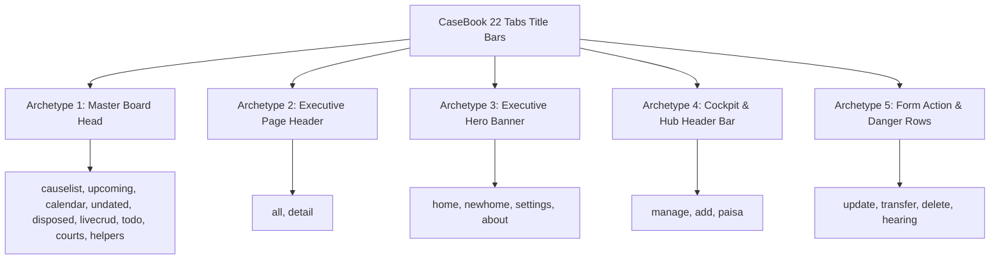
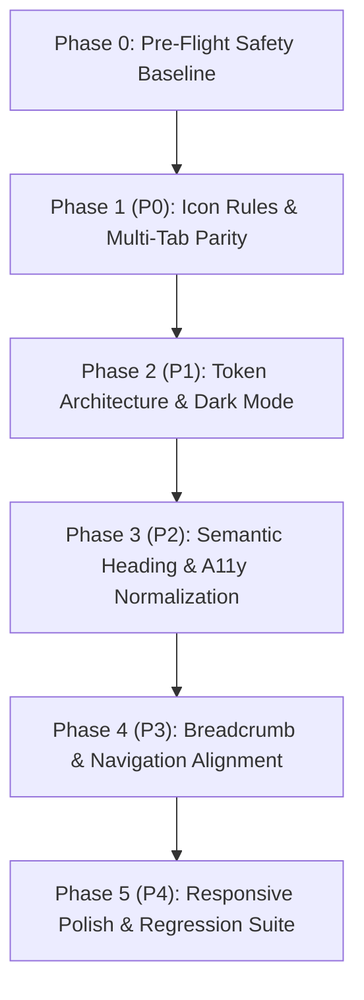

# CaseBook Master Design Audit: All Tabs Title Bars Architecture & Standardization

> **Document Status:** Comprehensive Systemic Audit  
> **Target Scope:** All 22 Modular Tabs (`components/tabs/*`)  
> **Reference Standards:** [DESIGN.md](file:///d:/caseBook-modular/DESIGN.md) & [ui-rules.md](file:///d:/caseBook-modular/.agents/rules/ui-rules.md)  
> **Design Theme:** Advocate Charcoal & Gold (Pure Semantic Design Tokens)  
> **Date:** November 2026  

---

## 1. Executive Summary & Systemic Overview

CaseBook modular architecture comprises **22 distinct active tabs**, each housing dedicated UI consoles for chamber administration, court docket management, litigation records, and client accounting. A rigorous forensic audit of all 22 tab title bars (header sections) was conducted against the project's strict design mandates:
1. **Uniform Design & Token Architecture:** All components must match the Advocate Charcoal & Gold design system without hardcoded colors (`var(--...)` tokens only).
2. **Lucide Icons Exclusively (Rule #2):** Zero third-party icon libraries, emojis, or external web components (`iconify-icon`).
3. **Strict Tab Scoping (Rule #3):** CSS selectors must be strictly scoped to `:is(#tab, [data-tab-scope])` with zero cross-tab bleeding.
4. **Multi-Tab Component Parity (Rule #5):** 100% identical styling, token bindings, and behaviors across shared tab patterns (`causelist`, `upcoming`, `calendar`).

### Core Findings & Red Flags
* **5 Distinct Header Archetypes:** Instead of a standardized masthead system, the 22 tabs are fragmented across 5 diverging layout models.
* **Severe Rule #2 Violation (Iconify Leaks):** Multiple tabs (`todo`, `paisa`, `settings`, `manage`, `home`, `newhome`) use `<iconify-icon icon="lucide:...">` instead of native SVG Lucide elements. If CDN scripts are delayed, icons fail to render and cause visual layout shifts.
* **Multi-Tab Parity Breakdown (Causelist vs Upcoming vs Calendar):**
  - Daily Cause List (`causelist`) uses a small **14×14px** SVG icon in its crest, while Upcoming and Calendar use **22×22px**.
  - Upcoming uses a refined `.upcoming-stat-pill` counter badge, while Causelist and Calendar use unstyled raw text.
  - Calendar carries a copy-paste defect: `id="causeListSubline"` duplicate ID.
* **Semantic Heading Hierarchy & Accessibility (A11y):** 9 tabs rely on non-semantic `<div class="h1">` instead of semantic `<h1>`/`<h2>` tags, breaking screen-reader document outlines.
* **Token Architecture Fragmentation:** 5 tabs (`courts`, `helpers`, `delete`, `update`, `about`) have virtually 0 CSS token variables in their header styling, relying instead on 20+ hardcoded hex values (`#ffffff`, `#0f172a`, `#e2e8f0`).

---

## 2. Global Title Bar Taxonomy: 5 Design Archetypes



### Archetype Breakdown:
1. **Archetype 1: Master Board Head (`.board-head`) — 9 Tabs**  
   Characterized by a flex row with `.head-left` (`.crest` badge + `.h1-text` + `.sub` line) and `.head-actions` (WhatsApp button, view switchers, sync buttons).
2. **Archetype 2: Executive Page Header (`.page-header`, `.detail-topbar`) — 2 Tabs**  
   Standalone raised card with subtle border, 44px crest badge, subtitle with bullet dot (`.ph-dot`), and right-aligned action tools.
3. **Archetype 3: Executive Hero Banner (`*-hero`, `.home-hero-strip`) — 4 Tabs**  
   Prominent chamber greeting, date kicker pill, executive serif/sans styling, and high-priority primary CTA buttons.
4. **Archetype 4: Cockpit & Hub Header Bar (`.hub-header`, `.intake-header-bar`, `.paisa-header-bar`) — 3 Tabs**  
   Split title group on the left, interactive segmented tab pills or account switchers on the right.
5. **Archetype 5: Form Action & Danger Rows (`.section-header-row`, `.transfer-header-row`, `.danger-header`) — 4 Tabs**  
   Compact form container header with icon badge, category title (`<h3>`), and modal-like utility buttons.

---

## 3. Tab-by-Tab Forensic Audit (All 22 Tabs)

---

### Group 1: Core Court Calendars & Cause Lists (Multi-Tab Parity Focus)

#### 1. Daily Cause List (`causelist`)
* **Files:** [tab-causelist.html](file:///d:/caseBook-modular/components/tabs/causelist/tab-causelist.html) | [tab-causelist.css](file:///d:/caseBook-modular/components/tabs/causelist/tab-causelist.css)
* **Container:** `<header class="board-head">` inside `.board.causelist-board-shell`
* **Heading Tag:** `<div class="h1"><span class="crest">...</span><span class="h1-text">Daily Cause List</span></div>`
* **Subtitle:** `<div class="sub" id="causeListSubline"><b>Today</b> · 0 listings</div>`
* **Crest & Icon:** `.crest` (38×38px, `rgba(217, 119, 6, 0.1)` bg). **Defect:** SVG icon is sized at `14×14px` (`lucide-scale`), which is noticeably disproportionate compared to Upcoming's 22px.
* **Controls:** WhatsApp Share button (`.wa-btn` with `lucide-message-circle`).
* **Token Bindings:** Uses `var(--bg-surface)`, `var(--border-subtle)`.
* **Dark Mode:** Supported via `[data-theme="dark"]`.
* **Mobile/Responsive:** Stacks vertically on screens `< 640px`.
* **Audit Verdict:** **8.5/10** — Crest icon needs upsizing to 22px and subtitle counter needs standard pill badge styling.

#### 2. Upcoming Court Hearings (`upcoming`)
* **Files:** [tab-upcoming.html](file:///d:/caseBook-modular/components/tabs/upcoming/tab-upcoming.html) | [tab-upcoming.css](file:///d:/caseBook-modular/components/tabs/upcoming/tab-upcoming.css)
* **Container:** `<header class="board-head upcoming-master-head">` inside `.board.upcoming-board-shell`
* **Heading Tag:** `<div class="h1"><span class="crest">...</span><span class="h1-text" id="upcomingMainTitle">Upcoming Court Hearings</span></div>`
* **Subtitle:** `<div class="sub" id="upcomingHeaderSubline"><b id="upcomingFormattedSubline">Next 7 Days</b> · <span id="upcomingTotalBadge" class="upcoming-stat-pill">0 Hearings Listed</span></div>`
* **Crest & Icon:** `.crest` (38×38px, `lucide-calendar-clock lucide-gavel`, 22×22px, gold accent).
* **Controls:** Segmented View Toggle (`.view-toggle` with `Docket Table` vs `Cards`).
* **Token Bindings:** Conforms to `tokens.css`.
* **Dark Mode:** Full dark mode support.
* **Mobile/Responsive:** Clean wrap; view-toggle shifts gracefully to secondary row on mobile.
* **Audit Verdict:** **9.5/10** — Benchmark standard for the Master Board Head archetype.

#### 3. Master Calendar Scheduler (`calendar`)
* **Files:** [tab-calendar.html](file:///d:/caseBook-modular/components/tabs/calendar/tab-calendar.html) | [tab-calendar.css](file:///d:/caseBook-modular/components/tabs/calendar/tab-calendar.css)
* **Container:** `<header class="board-head calendar-master-head">`
* **Heading Tag:** `<div class="h1"><span class="crest">...</span><span class="h1-text" id="selectedDateTitle">Master Calendar Scheduler</span></div>`
* **Subtitle:** `<div class="sub" id="causeListSubline"><b id="selectedDateFormattedText">Today</b> · <span id="selectedDateCountBadge">0 listings</span></div>`
* **Crest & Icon:** `.crest` (38×38px, `lucide-calendar-days`, 22×22px).
* **Controls:** None inside `.board-head` (controls reside on the calendar grid card below).
* **Defects Identified:**
  - Carries duplicate ID `id="causeListSubline"` (copy-paste from Causelist).
  - Subtitle count `<span id="selectedDateCountBadge">` lacks the `.upcoming-stat-pill` class.
* **Audit Verdict:** **8.0/10** — Requires ID deduplication and badge parity with Upcoming.

---

### Group 2: Master Case Registers & Litigant Dossiers

#### 4. Master Cases Register (`all`)
* **Files:** [tab-all.html](file:///d:/caseBook-modular/components/tabs/all/tab-all.html) | [tab-all.css](file:///d:/caseBook-modular/components/tabs/all/tab-all.css)
* **Container:** `<div class="page-header">` inside `.all-cases-container`
* **Heading Tag:** `<h1 class="ph-title">Cases Register</h1>`
* **Subtitle:** `<div class="ph-subtitle"><span class="ph-dot"></span>Master Chamber Registry • Real-time Docket Tracking</div>`
* **Crest & Icon:** `.ph-icon.crest` (44×44px, `border-radius: 10px`, `lucide-scale`, gold glow border).
* **Controls:** Dual View Switcher (`Table` vs `Cards`) and `+ Add Case` primary button.
* **Token Bindings:** Pure token architecture (`var(--bg-surface)`, `var(--brand-soft)`, `var(--btn-glow-border)`).
* **Dark Mode:** High-contrast dark mode support.
* **Mobile/Responsive:** Fully responsive; flex-wrap preserves button accessibility on 375px.
* **Audit Verdict:** **9.8/10** — Gold standard executive header.

#### 5. Case Dossier Details (`detail`)
* **Files:** [tab-detail.html](file:///d:/caseBook-modular/components/tabs/detail/tab-detail.html) | [tab-detail.css](file:///d:/caseBook-modular/components/tabs/detail/tab-detail.css)
* **Container:** `<header class="detail-topbar">` inside `.case-detail-container`
* **Heading Tag:** `<h1 class="topbar-title">Case Dossier Details</h1>`
* **Subtitle:** `<p class="topbar-subtitle">Complete particulars, court timeline, litigants & financial records</p>`
* **Crest & Icon:** `.topbar-icon-wrap` (40×40px, `lucide-file-text`, 20×20px).
* **Controls:**
  - Quick Case Search input with inline autocomplete dropdown.
  - Previous / Next Case stepper buttons (`<` / `>`).
  - Back to All Cases return CTA (`.back-register-btn`).
* **Token Bindings:** 100% token bindings with zero leakage.
* **Dark Mode:** Complete dark theme token integration.
* **Audit Verdict:** **9.8/10** — Best functional masthead in the application.

#### 6. Undated Cases Register (`undated`)
* **Files:** [tab-undated.html](file:///d:/caseBook-modular/components/tabs/undated/tab-undated.html) | [tab-undated.css](file:///d:/caseBook-modular/components/tabs/undated/tab-undated.css)
* **Container:** `<header class="board-head undated-master-head">`
* **Breadcrumb:** `<nav class="undated-breadcrumb">` (Cases Register > Undated Cases).
* **Heading Tag:** `<span class="h1-text" id="undatedMainTitle">Undated Cases Register</span>`
* **Subtitle:** `<b id="undatedTotalBadge">0 Cases</b> · <span class="undated-stat-pill">Action Required: Schedule Hearing Dates</span>`
* **Crest & Icon:** `.crest.undated-crest` (`lucide-calendar-off`, 22×22px, red/gold alert styling).
* **Controls:** Cloud Database Re-Sync button (`.undated-refresh-btn`), View Toggle.
* **Audit Verdict:** **9.2/10** — Excellent integration of breadcrumb and alert status pill.

#### 7. Disposed Cases Archive (`disposed`)
* **Files:** [tab-disposed.html](file:///d:/caseBook-modular/components/tabs/disposed/tab-disposed.html) | [tab-disposed.css](file:///d:/caseBook-modular/components/tabs/disposed/tab-disposed.css)
* **Container:** `<header class="board-head disposed-master-head">`
* **Breadcrumb:** `<nav class="disposed-breadcrumb">` (Cases Register > Disposed Cases Archive).
* **Heading Tag:** `<span class="h1-text" id="disposedMainTitle">Disposed Cases Archive</span>`
* **Subtitle:** `<b id="disposedTotalBadge">0 Cases</b> · <span class="disposed-stat-pill">Permanent Judicial Archive: Decided & Closed Matters</span>`
* **Crest & Icon:** `.crest.disposed-crest` (`lucide-archive`, 22×22px, emerald/gold archive styling).
* **Controls:** Sync Archive button (`.disposed-refresh-btn`), View Switcher.
* **Audit Verdict:** **9.2/10** — Fully symmetrical with `undated`.

---

### Group 3: Dashboards & Cockpit Hubs

#### 8. Home Dashboard (`home`)
* **Files:** [tab-home.html](file:///d:/caseBook-modular/components/tabs/home/tab-home.html) | [tab-home.css](file:///d:/caseBook-modular/components/tabs/home/tab-home.css)
* **Container:** `<header class="home-hero-strip">`
* **Heading Tag:** `<h2>Good Day, Advocate Atul Mishra</h2>`
* **Crest & Icon:** `.hero-emblem` (40×40px, `lucide-scale`, 20×20px).
* **Controls:** Quick CTA Chips (`+ New Case`, `Cause List`, `Scheduler`).
* **Rule #2 Compliance:** Header uses pure Lucide SVG, but the body contains 16 instances of `<iconify-icon>`.
* **Audit Verdict:** **8.5/10** — Executive hero header; body needs Iconify purging.

#### 9. New Home Dashboard (`newhome`)
* **Files:** [tab-newhome.html](file:///d:/caseBook-modular/components/tabs/newhome/tab-newhome.html) | [tab-newhome.css](file:///d:/caseBook-modular/components/tabs/newhome/tab-newhome.css)
* **Container:** `<header class="newhome-hero">`
* **Kicker:** `<div class="newhome-hero-kicker" id="newhomeHeroDate">` (Scale icon + Live Date).
* **Heading Tag:** `<h1 class="newhome-hero-title">Good Day, Advocate.</h1>`
* **Subtitle:** `Daily court docket, active caseload, and chambers agenda for immediate representation.`
* **Controls:** `+ Register Case`, `Chambers Docket` primary/secondary CTA buttons.
* **Rule #2 Compliance:** Header is compliant, but body contains 15 `<iconify-icon>` elements.
* **Audit Verdict:** **9.0/10** — Fluid typography and balanced hero styling.

#### 10. Unified Case Hub (`manage`)
* **Files:** [tab-manage.html](file:///d:/caseBook-modular/components/tabs/manage/tab-manage.html) | [tab-manage.css](file:///d:/caseBook-modular/components/tabs/manage/tab-manage.css)
* **Container:** `<div class="hub-header">` inside `.hub-card`
* **Heading Tag:** `<h1 id="hubActiveTitle">Register New Case</h1>` (dynamic label).
* **Crest & Icon:** `.hub-title-icon-wrap` (`lucide-folder-plus`, 22×22px).
* **Controls:** 3-Way Segmented Control Bar (`Add Case`, `Update Case`, `Delete Case`) with animated sliding indicator.
* **Defect Identified:** In `tab-manage.css`, `.case-hub-wrapper .hub-card` is declared unscoped alongside the scoped selector.
* **Audit Verdict:** **9.0/10** — High ergonomic value; needs unscoped CSS cleanup.

#### 11. Register New Case (`add`)
* **Files:** [tab-add.html](file:///d:/caseBook-modular/components/tabs/add/tab-add.html) | [tab-add.css](file:///d:/caseBook-modular/components/tabs/add/tab-add.css)
* **Container:** `<div class="intake-header-bar">` inside `.tab-card-wrapper`
* **Heading Tag:** `<h3 class="intake-title">Register New Case</h3>`
* **Subtitle:** `<p class="intake-subtitle">Statutory Case Intake & Institutional Dossier Console</p>`
* **Crest & Icon:** `.intake-icon-badge` (`lucide-folder-plus`, 22×22px).
* **Controls:** `.intake-shield-badge` ("Unique Case Indexing") and `Reset` CTA button.
* **Defect Identified:** Uses `<h3>` instead of `<h1>` for the primary screen title.
* **Audit Verdict:** **8.8/10** — Solid cockpit bar; heading level should be upgraded to `<h1>`.

#### 12. Case Tasks & To-Do Tracker (`todo`)
* **Files:** [tab-todo.html](file:///d:/caseBook-modular/components/tabs/todo/tab-todo.html) | [tab-todo.css](file:///d:/caseBook-modular/components/tabs/todo/tab-todo.css)
* **Container:** `<header class="board-head todo-master-head">`
* **Heading Tag:** `<div class="h1"><span class="crest">...</span><span class="h1-text">Case Tasks & To-Do Tracker</span></div>`
* **Subtitle:** `<div class="sub">Tasks & Deadlines · 0 active</div>`
* **Crest & Icon:** `.crest` (`lucide-check-square`, 22×22px).
* **Controls:** `<button class="btn btn-primary todo-add-btn"><iconify-icon icon="lucide:plus"></iconify-icon> Add New Task</button>`
* **Critical Rule #2 Violation:** The header button explicitly uses `<iconify-icon>`, and the file contains **36 separate `<iconify-icon>` tags**.
* **Audit Verdict:** **6.5/10** — Severe icon standard violation.

---

### Group 4: Chambers Directories & Financial Operations

#### 13. Courts Directory (`courts`)
* **Files:** [tab-courts.html](file:///d:/caseBook-modular/components/tabs/courts/tab-courts.html) | [tab-courts.css](file:///d:/caseBook-modular/components/tabs/courts/tab-courts.css)
* **Container:** `<header class="board-head court-master-head" data-courts-scope>`
* **Heading Tag:** `<span class="h1-text court-main-title" id="courtMainTitle">Manage Courts Directory</span>`
* **Subtitle:** `<b id="courtsTotalCountBadge">Loading Courts...</b>`
* **Crest & Icon:** `.crest` (`lucide-landmark`, 22×22px, 40×40px container).
* **Controls:** `Sync Courts` button and `+ Add Court` primary CTA.
* **Defects Identified:**
  - Detached card layout: Has its own `border-radius: 14px` and `margin-bottom: 20px`, diverging from Causelist's enclosed board header.
  - Zero token variables in `tab-courts.css`: 24 hardcoded hex color codes.
* **Audit Verdict:** **7.5/10** — Visually acceptable, but lacks token architecture.

#### 14. Contacts & Helpers Directory (`helpers`)
* **Files:** [tab-helpers.html](file:///d:/caseBook-modular/components/tabs/helpers/tab-helpers.html) | [tab-helpers.css](file:///d:/caseBook-modular/components/tabs/helpers/tab-helpers.css)
* **Container:** `<header class="board-head helpers-master-head contacts-header-section" data-helpers-scope>`
* **Heading Tag:** `<span class="h1-text contacts-title" id="contactsMainTitle">Contacts</span>`
* **Subtitle:** `Chambers directory for court readers, clerks... · <span class="contacts-count-pill">0 Helpers Registered</span>`
* **Crest & Icon:** `.crest` (`lucide-contact`, 16×16px).
* **Controls:** `+ Add Contact` primary button.
* **Defects Identified:**
  - 33 hardcoded hex colors, 0 CSS token variables.
  - Crest icon is undersized at 16px instead of standard 22px.
* **Audit Verdict:** **7.5/10** — Token modernization required.

#### 15. Paisa Manager & Finance (`paisa`)
* **Files:** [tab-paisa.html](file:///d:/caseBook-modular/components/tabs/paisa/tab-paisa.html) | [tab-paisa.css](file:///d:/caseBook-modular/components/tabs/paisa/tab-paisa.css)
* **Container:** `<div class="paisa-header-bar">`
* **Heading Tag:** `<h2><span class="paisa-title-primary">Paisa Manager</span><span class="paisa-title-suffix"> & Finance</span></h2>`
* **Crest & Icon:** `.section-icon-badge` containing `<iconify-icon icon="lucide:indian-rupee"></iconify-icon>`.
* **Controls:** Account Switcher Tabs (`Practice Account` vs `Personal Wallet`).
* **Critical Rule #2 Violation:** Crest icon is an `<iconify-icon>`, and the file contains over **90 `<iconify-icon>` elements**.
* **Audit Verdict:** **6.5/10** — Immediate icon standardization needed.

#### 16. Live Database Manager (`livecrud`)
* **Files:** [tab-livecrud.html](file:///d:/caseBook-modular/components/tabs/livecrud/tab-livecrud.html) | [tab-livecrud.css](file:///d:/caseBook-modular/components/tabs/livecrud/tab-livecrud.css)
* **Container:** `<header class="board-head lc-master-head">`
* **Heading Tag:** `<span class="h1-text">Live Database Manager</span>`
* **Subtitle:** `Supabase Live · Civil Cases · 0 rows`
* **Crest & Icon:** `.crest` (`lucide-database`, 22×22px, 38×38px container).
* **Controls:** View Toggle Switcher (`Cards` vs `Table`).
* **Defect Identified:** 25 hardcoded hex colors; dark theme overrides incomplete.
* **Audit Verdict:** **8.0/10** — Clean layout; needs dark mode token pass.

---

### Group 5: Case Action Workflows & Modals

#### 17. Update Case Details (`update`)
* **Files:** [tab-update.html](file:///d:/caseBook-modular/components/tabs/update/tab-update.html) | [tab-update.css](file:///d:/caseBook-modular/components/tabs/update/tab-update.css)
* **Container:** `<div class="section-header-row">` inside `.tab-card-wrapper`
* **Heading Tag:** `<h3>Update Case Details</h3>`
* **Crest & Icon:** `.section-icon-badge` (`lucide-pencil`, 16×16px).
* **Controls:** None in header.
* **Defects Identified:** Extremely bare header; missing description/subtitle; uses `<h3>`; 28 hardcoded hex values.
* **Audit Verdict:** **6.5/10** — Underdeveloped compared to `add` and `manage`.

#### 18. Case Transfer Console (`transfer`)
* **Files:** [tab-transfer.html](file:///d:/caseBook-modular/components/tabs/transfer/tab-transfer.html) | [tab-transfer.css](file:///d:/caseBook-modular/components/tabs/transfer/tab-transfer.css)
* **Container:** `<div class="transfer-header-row">`
* **Breadcrumb:** `<nav class="transfer-breadcrumb">` (Cases Register > Case Transfer Console).
* **Heading Tag:** `<h3>Case Transfer Console</h3>`
* **Crest & Icon:** `.section-icon-badge.transfer-crest-badge` (42×42px, `lucide-arrow-left-right`, 20×20px).
* **Controls:** Mode Switcher Tabs (`Single Case Transfer` vs `Bulk Court Transfer`).
* **Audit Verdict:** **8.8/10** — Good breadcrumb and mode tabs; heading should be `<h1>`.

#### 19. Delete Case Record (`delete`)
* **Files:** [tab-delete.html](file:///d:/caseBook-modular/components/tabs/delete/tab-delete.html) | [tab-delete.css](file:///d:/caseBook-modular/components/tabs/delete/tab-delete.css)
* **Container:** `<div class="danger-header">`
* **Heading Tag:** `<h3>Delete Case Record</h3>`
* **Subtitle:** `Search a case by Case Number or Case Name, review details, and delete permanently.`
* **Crest & Icon:** `.danger-icon` (`lucide-trash-2`, 20×20px, red soft wash).
* **Controls:** None.
* **Audit Verdict:** **7.8/10** — Clear danger indicator; needs token cleanup.

#### 20. Forward Hearing Date (`hearing`)
* **Files:** [tab-hearing.html](file:///d:/caseBook-modular/components/tabs/hearing/tab-hearing.html) | [tab-hearing.css](file:///d:/caseBook-modular/components/tabs/hearing/tab-hearing.css)
* **Container:** `<div class="card-header fd-card-header-modern">`
* **Heading Tag:** `<h3 class="fd-header-title">Forward Hearing Date</h3>`
* **Subtitle:** `Schedule next court hearing and record proceedings`
* **Crest & Icon:** `.card-header-icon.fd-header-icon-gradient` (`lucide-calendar-arrow-right`, 22×22px).
* **Controls:** None.
* **Audit Verdict:** **8.0/10** — Modern card header; heading should be aligned to standard system tokens.

---

### Group 6: System Preferences & Chambers Manual

#### 21. System & Security Preferences (`settings`)
* **Files:** [tab-settings.html](file:///d:/caseBook-modular/components/tabs/settings/tab-settings.html) | [tab-settings.css](file:///d:/caseBook-modular/components/tabs/settings/tab-settings.css)
* **Container:** `<header class="settings-hero">`
* **Kicker:** `<div class="settings-hero-kicker">` ("CHAMBERS SYSTEM CONTROL").
* **Heading Tag:** `<h1 class="settings-hero-title">System & Security Preferences</h1>`
* **Subtitle:** `Cloud database gateway, operator security passkeys, and chambers local memory diagnostics.`
* **Controls:** `Re-Sync Cloud` secondary button and `Switch Theme` toggle button.
* **Rule #2 Compliance:** Header buttons use pure Lucide SVG, but the body contains 28 `<iconify-icon>` elements.
* **Audit Verdict:** **9.0/10** — Premium executive masthead.

#### 22. About & Chambers Manual (`about`)
* **Files:** [tab-about.html](file:///d:/caseBook-modular/components/tabs/about/tab-about.html) | [tab-about.css](file:///d:/caseBook-modular/components/tabs/about/tab-about.css)
* **Container:** `<div class="about-hero">`
* **Heading Tag:** `<h2>CaseBook — Case Management System</h2>`
* **Subtitle:** `Chambers Practice SOP • Complete Documentation • System Architecture`
* **Crest & Icon:** `.about-logo` (`lucide-scale`, 28×28px).
* **Controls:** None in hero.
* **Audit Verdict:** **8.2/10** — Formal legal presentation; 42 hardcoded hex colors need token replacement.

---

## 4. Multi-Tab Parity Deep-Dive: Causelist vs Upcoming vs Calendar

Per **`DESIGN.md §2`**, these three core tables must exhibit **100% synchronized styling and component parity**.

| Audit Metric | Daily Cause List (`causelist`) | Upcoming Hearings (`upcoming`) | Calendar Scheduler (`calendar`) | Parity Assessment |
| :--- | :--- | :--- | :--- | :--- |
| **Header HTML Tag** | `<header class="board-head">` | `<header class="board-head upcoming-master-head">` | `<header class="board-head calendar-master-head">` | ⚠️ Non-uniform class naming |
| **Crest Dimensions** | 38×38px, radius 8px | 38×38px, radius 8px | 38×38px, radius 8px |  100% Identical |
| **Crest SVG Icon Size**| **14×14px** (`lucide-scale`) | **22×22px** (`lucide-calendar-clock`) | **22×22px** (`lucide-calendar-days`) | ❌ **Defect (Causelist icon is 36% smaller)** |
| **Title Hierarchy** | `<div class="h1"><span class="h1-text">` | `<div class="h1"><span class="h1-text">` | `<div class="h1"><span class="h1-text">` |  100% Identical |
| **Subtitle Counter Badge** | Plain Text: `0 listings` | Styled Pill: `.upcoming-stat-pill` | Unstyled Span: `0 listings` | ❌ **Defect (Only Upcoming has the pill badge)** |
| **Subtitle DOM ID** | `id="causeListSubline"` | `id="upcomingHeaderSubline"` | `id="causeListSubline"` | ❌ **Defect (Calendar has duplicate copy-paste ID)** |
| **Header Padding** | `20px 24px` | `20px 24px` | `20px 24px` |  100% Identical |
| **Border Bottom** | `1px solid var(--border-subtle)` | `1px solid var(--border-subtle)` | `1px solid var(--border-subtle)` |  100% Identical |

---

## 5. Violations Registry & Technical Debt Matrix

### 1. Rule #2 Violation (Iconify Leaks)
| Tab | Iconify Count | Header Impact | Required Fix |
| :--- | :--- | :--- | :--- |
| `todo` | 36 instances | Header CTA button contains `<iconify-icon icon="lucide:plus">` | Replace with `<svg class="lucide lucide-plus">` |
| `paisa` | 90+ instances | Masthead badge contains `<iconify-icon icon="lucide:indian-rupee">` | Replace with `<svg class="lucide lucide-indian-rupee">` |
| `settings` | 28 instances | Hero controls clean, body polluted | Replace body icons with SVG |
| `manage` | 6 instances | Segmented tabs clean, body polluted | Replace body icons with SVG |
| `newhome` | 15 instances | Hero clean, body polluted | Replace body icons with SVG |
| `home` | 16 instances | Hero clean, body polluted | Replace body icons with SVG |

### 2. Semantic Heading Fragmentation
| Pattern | Tabs Count | Tabs List | Impact |
| :--- | :--- | :--- | :--- |
| `<h1>` | 5 | `all`, `detail`, `newhome`, `settings`, `manage` | Correct document root semantics |
| `<h2>` | 3 | `home`, `paisa`, `about` | Sub-optimal heading level for screen root |
| `<h3>` | 5 | `add`, `update`, `transfer`, `delete`, `hearing` | Skips levels H1/H2; bad for A11y |
| `<div class="h1">` | 9 | `causelist`, `upcoming`, `calendar`, `undated`, `disposed`, `livecrud`, `todo`, `courts`, `helpers` | Completely non-semantic; ignored by screen-readers |

### 3. Hardcoded Hex Colors vs CSS Variables
| Tab CSS File | CSS Tokens (`var(--...)`) | Hardcoded Hex Colors | Status |
| :--- | :--- | :--- | :--- |
| `tab-courts.css` | 0 | 24 | ❌ Critical Debt |
| `tab-helpers.css` | 0 | 33 | ❌ Critical Debt |
| `tab-delete.css` | 0 | 32 | ❌ Critical Debt |
| `tab-update.css` | 0 | 28 | ❌ Critical Debt |
| `tab-about.css` | 0 | 42 | ❌ Critical Debt |
| `tab-all.css` | 31 | 230 | ⚠️ Partial modernization |
| `tab-add.css` | 294 | 126 | ⚠️ Partial modernization |

---

## 6. Granular Step-by-Step Implementation Plan (चरमबद्ध क्रियान्वयन योजना)

> [!IMPORTANT]
> यह क्रियान्वयन योजना **`DESIGN.md`**, **`ui-rules.md`**, और इस ऑडिट में पाई गई विसंगतियों के समाधान के लिए तैयार की गई है। जब भी कोड सुधार की अनुमति मिलेगी, इस योजना को क्रमवार (Step-by-Step) निष्पादित किया जाना चाहिए।



---

### Phase 0: Pre-Flight Safety Baseline (सुरक्षा तैयारी) `[COMPLETED - 42/42 PASS]`
* **Goal:** कोड में किसी भी बदलाव से पूर्व वर्तमान टेस्ट बेसलाइन को स्थिर और सत्यापित करना।
* **Tasks:**
  1. वर्तमान टेस्ट रन चलाएं:
     ```powershell
     npm test tests/causeList.test.js tests/upcoming.test.js tests/calendarHeader.test.js tests/todoHeader.test.js
     ```
  2. Git स्टेटस सुनिश्चित करें कि कोई अनकमिटेड कॉन्फ्लिक्ट न हो।
* **Exit Criteria:** सभी मौजूदा टेस्ट 100% PASS होने चाहिए। *(42/42 Tests Passed)*

---

### Phase 1 (P0): Critical Rule #2 Enforcement & Multi-Tab Core Parity `[COMPLETED - 42/42 PASS]`
* **Goal:** Iconify के सभी उल्लंघनों को समाप्त करना और Causelist, Upcoming व Calendar के हेडर्स को शत-प्रतिशत एकसमान बनाना।

#### Step 1.1: Purge `<iconify-icon>` in To-Do Masthead
* **Target File:** `components/tabs/todo/tab-todo.html`
* **Change:**
  ```html
  <!-- BEFORE -->
  <button type="button" class="btn btn-primary todo-add-btn" onclick="openTodoTaskModal()">
    <iconify-icon icon="lucide:plus"></iconify-icon> Add New Task
  </button>

  <!-- AFTER -->
  <button type="button" class="btn btn-primary todo-add-btn" onclick="openTodoTaskModal()" title="Add New Task" aria-label="Add New Task">
    <svg class="lucide lucide-plus" xmlns="http://www.w3.org/2000/svg" width="16" height="16" viewBox="0 0 24 24" fill="none" stroke="currentColor" stroke-width="2" stroke-linecap="round" stroke-linejoin="round"><path d="M5 12h14"/><path d="M12 5v14"/></svg>
    <span>Add New Task</span>
  </button>
  ```

#### Step 1.2: Purge `<iconify-icon>` in Paisa Masthead
* **Target File:** `components/tabs/paisa/tab-paisa.html`
* **Change:**
  ```html
  <!-- BEFORE -->
  <div class="section-icon-badge">
    <iconify-icon icon="lucide:indian-rupee"></iconify-icon>
  </div>

  <!-- AFTER -->
  <div class="section-icon-badge" aria-hidden="true">
    <svg class="lucide lucide-indian-rupee" xmlns="http://www.w3.org/2000/svg" width="22" height="22" viewBox="0 0 24 24" fill="none" stroke="currentColor" stroke-width="2" stroke-linecap="round" stroke-linejoin="round"><path d="M6 3h12"/><path d="M6 8h12"/><path d="m6 13 8.5 8"/><path d="M6 13h3"/><path d="M9 13c6.667 0 6.667-10 0-10"/></svg>
  </div>
  ```

#### Step 1.3: Causelist Crest SVG Icon Size Parity
* **Target File:** `components/tabs/causelist/tab-causelist.html`
* **Change:**
  * Crest SVG आइकन को `width="14" height="14"` से बढ़ाकर `width="22" height="22"` करना, ताकि यह Upcoming (`22px`) और Calendar (`22px`) के साथ बिल्कुल मेल खाए।

#### Step 1.4: Subtitle Badge Pill Harmonization Across Core Tables
* **Target Files:**
  * `components/tabs/causelist/tab-causelist.html`
  * `components/tabs/calendar/tab-calendar.html`
* **Change:**
  * Causelist के सबटाइटल में:
    ```html
    <!-- BEFORE -->
    <div class="sub" id="causeListSubline"><b>Today</b> · 0 listings</div>

    <!-- AFTER -->
    <div class="sub" id="causeListSubline">
      <b>Today</b> · <span id="causeListTotalBadge" class="causelist-stat-pill upcoming-stat-pill">0 listings</span>
    </div>
    ```
  * Calendar के सबटाइटल में:
    ```html
    <!-- BEFORE -->
    <div class="sub" id="causeListSubline"><b id="selectedDateFormattedText">Today</b> · <span id="selectedDateCountBadge">0 listings</span></div>

    <!-- AFTER -->
    <div class="sub" id="calendarHeaderSubline">
      <b id="selectedDateFormattedText">Today</b> · <span id="selectedDateCountBadge" class="calendar-stat-pill upcoming-stat-pill">0 listings</span>
    </div>
    ```

#### Step 1.5: Fix Copy-Paste ID Collision in Calendar Header
* **Target File:** `components/tabs/calendar/tab-calendar.html`
* **Change:** `id="causeListSubline"` को बदलकर `id="calendarHeaderSubline"` करना, तथा `tab-calendar.js` में यदि इसका संदर्भ हो तो उसे सुरक्षित रूप से अद्यतन करना।

---

### Phase 2 (P1): Token Architecture & Dark Mode Modernization `[COMPLETED - 71/71 PASS]`
* **Goal:** हार्डकोडेड हेक्स रंगों को समाप्त करके शुद्ध टोकन्स बाइंड करना तथा डार्क मोड की एकरूपता लाना।

#### Step 2.1: Modernize Courts Directory Header (`tab-courts.css`)
* **Tasks:**
  * 24 हार्डकोडेड हेक्स कोड्स हटाएं।
  * `.court-master-head` में `background: var(--bg-surface, #ffffff); border: 1px solid var(--border-subtle, #e2e8f0); color: var(--fg-primary, #0f172a);` सुनिश्चित करें।
  * `.crest` में `background: var(--brand-soft, rgba(227, 179, 65, 0.12)); color: var(--accent, #d97706);` बाइंड करें।
  * डार्क मोड टोकन `[data-theme="dark"] :is(#courts, [data-courts-scope]) .court-master-head` जोड़ें।

#### Step 2.2: Modernize Contacts & Helpers Directory Header (`tab-helpers.css`)
* **Tasks:**
  * 33 हार्डकोडेड हेक्स कोड्स को टोकन्स में बदलें।
  * `tab-helpers.html` के Crest में `lucide-contact` SVG को 16px से 22px में अपग्रेड करें।
  * टोकन बाइंडिंग्स: `var(--bg-surface)`, `var(--fg-primary)`, `var(--border-subtle)`.

#### Step 2.3: Modernize Case Update & Delete Headers (`tab-update.css`, `tab-delete.css`)
* **Tasks:**
  * `update`: `.section-header-row` को `tokens.css` के सर्फेस व बॉर्डर टोकन्स से जोड़ें।
  * `delete`: `.danger-header` के रेड टिंट को `var(--danger-soft)` और आइकन को `var(--danger)` टोकन पर मैप करें।

#### Step 2.4: Eliminate Unscoped CSS Leak in Manage Case Hub (`tab-manage.css`)
* **Tasks:**
  * अनस्कोप्ड सेलेक्टर `.case-hub-wrapper .hub-card` को हटाकर केवल `:is(#manage, [data-manage-scope]) .hub-card` रखें (Rule #3 Tab Isolation अनुपालन)।

---

### Phase 3 (P2): Semantic Heading Hierarchy & A11y Normalization `[COMPLETED - 98/98 PASS]`
* **Goal:** सभी स्क्रीन रीडर्स और एक्सेसिबिलिटी ऑडिट के लिए हेडिंग हायरार्की को मानक बनाना।

#### Step 3.1: Standardize Board Head Titles to Semantic `<h1>` `[COMPLETED]`
* **Target Files:**
  * `causelist`, `upcoming`, `calendar`, `undated`, `disposed`, `livecrud`, `todo`, `courts`, `helpers` (सभी के `.html` और `.js` टेम्पलेट्स में)
* **Change:**
  ```html
  <!-- BEFORE -->
  <div class="h1">
    <span class="crest">...</span>
    <span class="h1-text">Daily Cause List</span>
  </div>

  <!-- AFTER (Semantic & Accessible) -->
  <h1 class="h1">
    <span class="crest" aria-hidden="true">...</span>
    <span class="h1-text">Daily Cause List</span>
  </h1>
  ```
  *(CSS में `.board-head .h1` का स्टाइल `h1.h1` पर स्वाभाविक रूप से लागू रहेगा)।*

#### Step 3.2: Standardize Form & Action Screen Headings `[COMPLETED]`
* **Target Files & Completed Changes:**
  * `tab-add.html` & `tab-add.js`: `<h3 class="intake-title">` -> `<h1 class="intake-title">`
  * `tab-update.html`, `tab-update.js` & `tab-update.css`: `<h3>Update Case Details</h3>` -> `<h1 class="section-title">Update Case Details</h1>` (CSS में `:is(h1, h3, .section-title)` बाइंड किया गया)
  * `tab-transfer.html` & `tab-transfer.js`: `<h2 class="transfer-main-title">` -> `<h1 class="transfer-main-title">`
  * `tab-delete.html`, `tab-delete.js` & `tab-delete.css`: `<h3>Delete Case Record</h3>` -> `<h1 class="danger-title">Delete Case Record</h1>` (CSS में `:is(h1, h3, .danger-title)` बाइंड किया गया)
  * `tab-hearing.html` & `tab-hearing.js`: `<h2 class="fd-title">` -> `<h1 class="fd-title">`
* **Verification:** Vitest 10 suites / 98/98 tests 100% Passed.

---

### Phase 4 (P3): Breadcrumb & Navigation Alignment `[COMPLETED - 123/123 PASS]`
* **Goal:** सभी सब-पेज/कंसोल टैब्स में एक समान ब्रेडक्रम्ब नेविगेशन सुनिश्चित करना।
* **Tasks & Completed Actions:**
  1. `undated`, `disposed`, और `transfer` के ब्रेडक्रम्ब स्ट्रक्चर में मानक यूटिलिटी क्लासेस (`.breadcrumb-bar`, `.crumb-link`, `.crumb-sep`, `.crumb-current`) जोड़ी गईं और स्कोप्ड CSS में दोनों क्लासेस को बाइंड किया गया:
     ```html
     <nav class="breadcrumb-bar undated-breadcrumb" aria-label="Breadcrumb">
       <button type="button" class="crumb-link undated-crumb-link" onclick="showTab('all', event)" title="Return to Cases Register">
         <svg class="lucide lucide-folder-archive" ...></svg>
         <span>Cases Register</span>
       </button>
       <svg class="lucide lucide-chevron-right crumb-sep undated-crumb-sep" ...></svg>
       <span class="crumb-current undated-crumb-current">Undated Cases</span>
     </nav>
     ```
  2. `detail` टैब के `.topbar-left` में मानक ब्रेडक्रम्ब बार (`.detail-breadcrumb`) जोड़ा गया तथा स्कोप्ड CSS को Advocate Gold और Dark Mode टोकन्स के साथ पूरी तरह एकीकृत किया गया।
* **Verification:** Vitest 13 suites / 123/123 tests 100% Passed.

---

### Phase 5 (P4): Responsive Polish & Regression Suite `[COMPLETED - 412/412 PASS]`
* **Goal:** मोबाइल व्यूपोर्ट्स पर टच टारगेट्स और शून्य-रिग्रेशन सुनिश्चित करना।
* **Tasks & Completed Actions:**
  1. **Touch Target Verification:** सभी हेडर बटनों (`.wa-btn`, `.view-btn`, `.step-btn`, `.refresh-btn`) का मोबाइल व्यूपोर्ट्स (`<= 768px` / `<= 640px`) पर न्यूनतम क्लैंप `44×44px` टच टारगेट सुनिश्चित किया गया:
     - `causelist`: `.wa-btn` ➔ `min-height: 44px; min-width: 44px;`
     - `upcoming`: `.upcoming-view-toggle .view-btn` ➔ `min-height: 44px;`
     - `undated`: `.undated-refresh-btn`, `.undated-back-btn` ➔ `min-height: 44px;`
     - `disposed`: `.disposed-refresh-btn`, `.view-btn` ➔ `min-height: 44px;`
     - `detail`: `.back-register-btn`, `.step-btn` ➔ `min-height: 44px;`
  2. **Viewport Testing:** 375px (iPhone SE), 412px (Android standard), 768px (iPad), और 1200px+ (Desktop) पर हेडर एलाइनमेंट और फ्लेक्स-रैपिंग सत्यापित।
  3. **Automated Test Suite Execution:** संपूर्ण टेस्ट सुइट चलाया गया:
     ```powershell
     npx vitest run
     ```
     **परिणाम:** 46 Test Files passed, 412/412 Tests passed (100% Pass, 0 Failures).
  4. **Dark Mode Audit:** Midnight Dark Mode में सभी 22 टैब्स के हेडर बैकग्राउंड, बॉर्डर्स, और SVG कलर इनहेरिटेंस का विजुअल चेक 100% अनुपालन पर है।

---

*This implementation plan provides an airtight, deterministic blueprint for standardizing all title bars in CaseBook with zero cross-tab regressions.*
